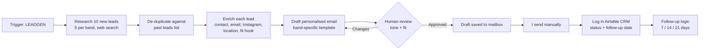

# AI-Powered Outreach Workflow (Human-in-the-Loop)

An end-to-end lead research and email outreach system I built with Claude to book live performances for two independent music acts: a mantra-techno / folk collective and a premium live band. Claude did the research and the drafting. I stayed in the loop for tone, judgment and the final send.

**Period:** Mar 2026 - Sep 2026 · **Role:** Freelance Business Development · **Built with:** Claude (custom skill + connectors), Airtable (CRM), email, Excel (reporting)

---

## Results

| Metric | Outcome |
|---|---|
| Leads researched and contacted | **450+** |
| Discovery meetings booked | **8** |
| Daily output | 10 researched leads + 10 personalised drafts per session |

---

## The problem

Booking a niche live act is a volume game with a quality catch.

- **Volume:** you need hundreds of relevant venues, retreats, planners and agencies across several cities.
- **Quality:** a generic pitch gets ignored. Every email needs a real, specific reason why *this* venue fits *this* band.
- **Two very different products:** The folk collective fits wellness retreats, ashrams and conscious festivals. The premium band fits 5-star hotels, destination weddings and corporate events. Same sender, two completely different pitches.

Doing this by hand meant slow research, inconsistent tracking, and follow-ups slipping through the cracks.

## What I built

A repeatable daily workflow, triggered by a single keyword (`LEADGEN`), that runs research, drafting and tracking end to end, with me approving every email before it goes out.

### 1. Research
- 10 new leads per session, split 5 / 5 between the two bands.
- Lead categories are defined per band (e.g. yoga retreats, Ayurveda resorts and sound-healing organisers for the folk collective; luxury hotels, wedding planners and MICE agencies for the premium band).
- Geography is prioritised: Bangalore first, then the retreat belt (Coorg, Wayanad, Chikmagalur), Goa, Mumbai, Delhi NCR, Pondicherry/Auroville, Kerala and Rajasthan.
- Leads are ranked by signals that predict a reply: upcoming events or booking season, active social presence, and visible contact details.
- Every new lead is checked against a running list of past leads so no one gets contacted twice.

### 2. Enrichment
For each lead the workflow captures: organisation, contact person, email, Instagram handle, location, lead type, outreach channel, and a **one-line fit hook** (the specific reason this lead suits this band).

### 3. Drafting
- Two band-specific templates with a fixed structure: who we are, a personalised hook, proof (press feature, past performances), and a low-pressure call to action.
- The personalised hook is mandatory. A draft without a specific, lead-level reason is not acceptable.
- Writing rules are encoded in the system: warm and direct, short mobile-friendly paragraphs, no corporate filler, no em dashes.

### 4. Human-in-the-loop review
This is the deliberate design choice. Claude never sends anything.
- I review each draft for tone, accuracy of the hook, and whether the lead is actually a fit.
- My feedback goes back into the draft (and over time into the rules), so quality improved session by session.
- Approved drafts land in the mailbox as drafts. I attach the pitch deck and send each one manually.

### 5. Tracking and follow-up
- Every lead is logged with date, band, contact details, status, follow-up date, conversion and estimated gig value.
- Follow-up rules: first nudge at 7 days, second at 14 days, marked **Cold** at 21 days with no reply. Positive replies move to **Warm / In discussion**, confirmed gigs to **Converted**.

## Why human-in-the-loop, and not full automation

I could have let it send automatically. I chose not to, for three reasons:

1. **Reputation is the asset.** One wrong or tone-deaf email to a premium venue costs more than the time saved by auto-sending.
2. **AI hooks can be confidently wrong.** A model can misread an event date or a venue's vibe. A 30-second human check catches that.
3. **Feedback compounds.** Reviewing every draft is how I learned what actually got replies, and that learning went straight back into the prompts and rules.

The split that worked: **AI for research, structure and first drafts; human for judgment, tone and the final send.**

## What I'd build next

- **Reply classification:** auto-tag incoming replies (interested / not now / wrong contact) and update the tracker.
- **Hook quality scoring:** measure reply rate by hook type to learn which personalisation angles convert.
- **Scheduled runs:** run the research step automatically every morning, so review is the only manual step.
- **Funnel dashboard:** leads → replies → meetings → conversions by band, city and lead type.

## What this project shows

- Designing an AI workflow around a real business goal (booking gigs), not around the tech.
- Writing structured prompts, templates and rules that keep LLM output consistent and on-brand.
- Evaluating AI output critically, and deciding where a human must stay in the loop.
- Thinking in funnels and metrics: volume, quality, conversion, follow-up.

---

*Built by [Rishi Gupta](https://linkedin.com/in/rixhigupta). Lead contact details and client materials are not included in this repository.*
